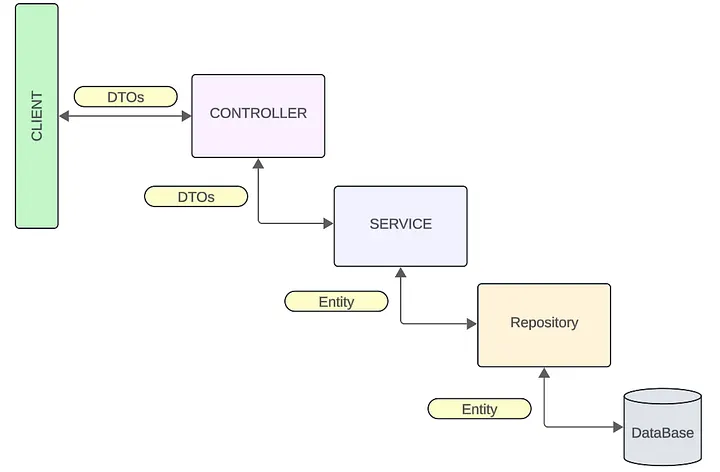

# Pulse Products API

API REST para gerenciamento de produtos, desenvolvida com Java 27 e Spring Boot 4.1.2.

O projeto implementa operações de CRUD, validação de dados, paginação, tratamento global de exceções e documentação interativa dos endpoints. Foi desenvolvido para baseado em conceitos de desenvolvimento backend, persistência de dados e arquitetura em camadas.

## Tecnologias

| Tecnologia | Responsabilidade |
|---|---|
| Java 27 | Linguagem principal |
| Spring Boot 4.1.2 | Framework da aplicação |
| Spring Web MVC | Criação dos endpoints REST |
| Spring Data JPA / Hibernate | Persistência e mapeamento objeto-relacional |
| H2 Database | Banco de dados relacional em memória |
| Bean Validation | Validação dos dados de entrada |
| Lombok | Redução de código boilerplate |
| JUnit 5, Mockito e AssertJ | Testes automatizados |
| Springdoc OpenAPI / Swagger UI | Documentação interativa da API |
| Maven | Gerenciamento de dependências e build |
| Docker | Execução da aplicação em container |

## Funcionalidades

- Cadastro de produtos.
- Consulta de produto por ID.
- Listagem de produtos com paginação.
- Atualização de produtos existentes.
- Exclusão de produtos.
- Validação dos dados recebidos.
- Verificação de nomes duplicados.
- Tratamento global de exceções.
- Documentação dos endpoints com Swagger UI.
- Testes automatizados de serviços e repositórios.

## Arquitetura

A imagem a seguir apresenta uma visão geral da arquitetura e do funcionamento da aplicação, destacando seus principais componentes e como eles se relacionam.



<!--
Salve a imagem, por exemplo, em docs/images/arquitetura.png e substitua o espaço reservado pela referência abaixo:


-->

### Responsabilidades das camadas

- **Controller:** recebe as requisições HTTP e retorna as respostas da API.
- **DTOs:** definem os dados de entrada e saída, separando o contrato HTTP das entidades.
- **Service:** concentra as regras de negócio e coordena as operações.
- **Mapper:** converte DTOs em entidades e entidades em DTOs de resposta.
- **Entity:** representa os produtos persistidos no banco de dados.
- **Repository:** realiza operações de consulta e persistência por meio do Spring Data JPA.
- **Exceptions:** reúne as exceções de negócio e o tratamento global de erros.

O fluxo principal de uma requisição é:

`Cliente → Controller → Service → Repository → H2 Database`

Os DTOs e o Mapper auxiliam na transferência e conversão dos dados entre as camadas.

## Endpoints

A API utiliza o prefixo `/api/products`.

| Método | Endpoint | Descrição | Resposta de sucesso |
|---|---|---|---|
| `POST` | `/api/products` | Cadastra um produto | `201 Created` |
| `GET` | `/api/products` | Lista produtos com paginação | `200 OK` |
| `GET` | `/api/products/{id}` | Busca um produto por ID | `200 OK` |
| `PUT` | `/api/products/{id}` | Atualiza um produto | `200 OK` |
| `DELETE` | `/api/products/{id}` | Exclui um produto | `204 No Content` |

### Paginação

A listagem aceita parâmetros de consulta (*query params*) para controlar a paginação.

| Parâmetro | Descrição | Padrão |
|---|---|---|
| `page` | Número da página, começando em zero | `0` |
| `size` | Quantidade de itens por página | `10` |

Exemplo: listar os primeiros 10 produtos.

```http
GET /api/products?page=0&size=10&sort=name,asc
```

A paginação começa em zero: `page=0` representa a primeira página.

### Exemplo de cadastro

Requisição:

```http
POST /api/products
Content-Type: application/json
```

Corpo da requisição:

```json
{
  "name": "Mouse",
  "description": "Mouse sem fio",
  "price": 89.90,
  "amount": 15
}
```

Os campos são validados antes de a operação ser processada. Por exemplo, o nome não pode estar vazio, o preço não pode ser negativo e a quantidade deve ser igual ou superior a zero.

Os demais contratos, parâmetros e respostas podem ser consultados no Swagger UI.

## Pré-requisitos

Para executar localmente:

- JDK 27 instalado.
- Git.
- Maven Wrapper, incluído no projeto.

Para executar com Docker:

- Docker instalado e em execução.
- `Dockerfile` está configurado na raiz do projeto.

## Como executar localmente

### 1. Clonar o repositório

```bash
git clone https://github.com/euviniciuss/pulse-products
cd pulse-products
```

### 2. Executar a aplicação

No macOS ou Linux:

```bash
chmod +x mvnw
./mvnw spring-boot:run
```

No Windows:

```bash
mvnw.cmd spring-boot:run
```

Após a inicialização, a API estará disponível na porta configurada no projeto, normalmente `8080`.

### 3. Acessar a documentação

Com a aplicação em execução, acesse:

- **Swagger UI:** http://localhost:8080/swagger-ui/index.html
- **OpenAPI JSON:** http://localhost:8080/v3/api-docs

O Swagger UI permite explorar os endpoints, consultar os contratos e executar requisições diretamente pelo navegador.

## Como executar com Docker

Com o `Dockerfile` na raiz do projeto, construa a imagem:

```bash
docker build -t pulse-products .
```

Em seguida, execute o container:

```bash
docker run --rm -p 8080:8080 pulse-products
```

A API poderá ser acessada em `http://localhost:8080`, desde que a aplicação esteja configurada para utilizar essa porta.

> **Observação:** esses comandos pressupõem que o `Dockerfile` esteja configurado para construir e iniciar a aplicação. O Dockerfile não foi incluído no contexto, portanto, os comandos devem ser conferidos com sua configuração real.

## Banco de dados

O projeto utiliza o **H2 Database**, um banco de dados relacional em memória, configurado no arquivo `application.yml`.

Essa configuração facilita a execução local e os testes sem exigir a instalação de um servidor de banco de dados separado. Por utilizar uma base em memória, os dados normalmente são perdidos quando a aplicação é encerrada.

## Testes automatizados

Os testes utilizam JUnit 5 e Mockito para verificar os comportamentos da aplicação, incluindo regras de negócio e operações do repositório.

Executar todos os testes:

```bash
./mvnw test
```

Executar os testes do serviço:

```bash
./mvnw -Dtest=ProductServiceImplTest test
```

Executar os testes do controller:

```bash
./mvnw -Dtest=ProductControllerTest test
```

Limpar, executar os testes e gerar o pacote:

```bash
./mvnw clean package
```

## Tratamento de erros

A aplicação utiliza `@RestControllerAdvice` para centralizar o tratamento de exceções dentro do arquivo de `GlobalExpecptionHandler`.

| Status HTTP | Significado |
|---|---|
| `400 Bad Request` | Dados de entrada inválidos ou identificador em formato inválido |
| `404 Not Found` | Produto não encontrado |
| `409 Conflict` | Conflito de negócio, como tentativa de cadastrar um produto com nome duplicado |
